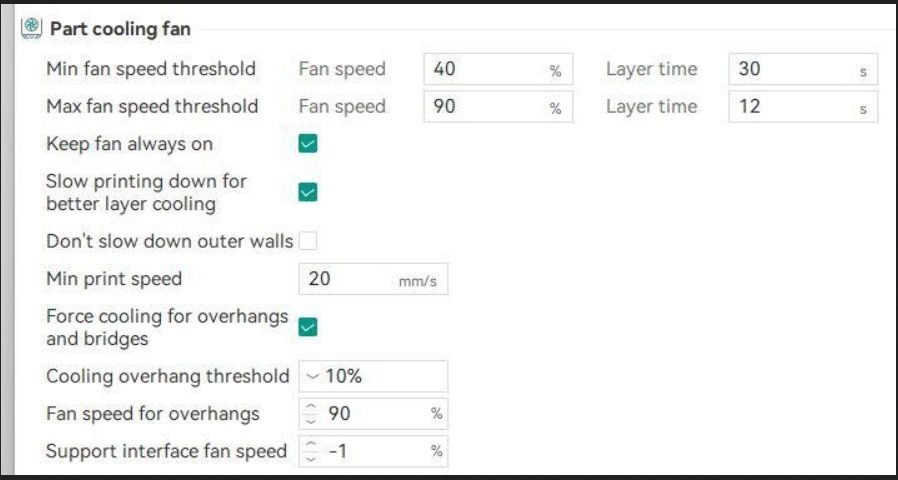

## Robot Hand → Herny
## Sensorised Glove → Will

The operator is the one commanding the motion. Their finger position is the input. This means that when Henry makes contact with something, the break system will stop the user from being able to move their finger. This will make it so that Henry's finger position matches Will's anyways since the user is the one that controls the fingers.

You actually don't need encoders or anything on Will since the clamp will resist you at that position. So technically the servos from Will and the servos in Henry don't need to be connected. The real calibration will be between the flex resistors on Will and the servos on Henry.

So the two directions are not symmetric, and that's the whole resolution:

- Forward (command): will bend → mapped (calibrated, because kinematics differ) → henry servo target. Angle translation lives here.
- Return (feedback): henry fingertip force → one bit (contact / no contact) → will brake locks at current position. No angle translation at all.

Start instead of doing a full build, do it so that you can test that the haptics work with using only one finger on the sensorised glove.

NEW DESIGN OF THE HAND: https://arxiv.org/pdf/2509.03690

I think it would be good to make the CAD for the servos yourself since it would be quite hard to make it without.

USE CHUNKING FOR THE ESP_NOW.
[esp_now chunking](https://www.digikey.sg/zh/maker/tutorials/2024/how-to-transmit-messages-to-unlimited-receivers-in-esp-now)

[MLX90393 DATASHEET](https://uk.store.bambulab.com/products/tpu-for-ams?id=532448685015678999)
[MLX90393 VISUALISATION](https://github.com/notvenky/eFlesh/tree/main/visualizer)

